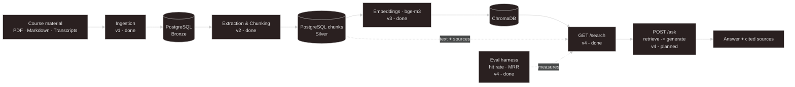

# project3-kms - A Knowledge Management System

**Status:** MVP v4 in progress - search API and retrieval baseline built, answer endpoint next · last release `v3.0.0`

## 1. Problem & Approach

Data engineering students face scattered course material - unindexed slides, markdown repos, hours of video transcripts. Generic LLM tools hallucinate freely and have no awareness of a specific curriculum's actual content.

`project3-kms` is a Retrieval-Augmented Generation (RAG) knowledge system built over a real corpus - 692 PDF, markdown and transcript files across 13 courses from a data engineering program (STI, DE25) - organized through a **medallion-layered pipeline** (`Bronze` -> `Silver` -> `Gold`). **The design goal**: every answer traces back to its exact source chunk, not a plausible-sounding guess.

Built as a **thesis project**, staged across six MVPs. Ingestion, extraction, chunking and embedding are complete and tagged `v3.0.0` (MVP v1-v3). MVP v4 is in progress: a semantic search endpoint is built and tested, and retrieval quality has a measured baseline. Text cleaning comes next, measured against that same baseline, then a source-cited answer endpoint. A bounded self-correction loop, orchestration and production deployment follow through MVP v6.

## 2. The Corpus, Measured

Every figure below was counted against disk and against the database on 2026-11-08, never estimated. The gaps between them are the interesting part.

| | |
|---|---|
| Supported files on disk (PDF + markdown/transcript) | **692** |
| Rows in `source_files` - one per file on disk | **692** |
| Rows in `documents` - one per unique content | **631** (266 markdown, 94 PDF, 271 transcript) |
| Files whose content already exists in another file | **61** - kept as provenance, not dropped |
| Embedded / failed | **624** `EMBEDDED` · **7** `FAILED` |
| Chunks in Postgres / vectors in ChromaDB | **7820** / **7820** - reconciled in both directions |
| Full rebuild from an empty stack | **~112 s** (~88 s of it embedding) via `tools/rebuild.py` |
| Test suite | **103 unit tests**, 0 integration |

### Found and fixed

Earlier versions of this README listed three open gaps. They stay listed here, because finding them was the work.

- **272 transcript files were not ingested.** They live in mirror folders whose names carry the course they belong to, while ingestion derived the course tag from the filename. Deriving it from the folder unlocked all 272 with no new mapping rules.

- **A file reused across courses collapsed to one row with one course tag.** Correct for storage, wrong for course-filtered retrieval. The fix split *what the content is* from *where it lives*: `documents` holds one row per unique content, `source_files` one row per file on disk with its own course. It landed before anything was embedded, so nothing had to be re-embedded.

- **A slide deck that extracts to almost nothing used to pass as `EXTRACTED`.** Every PDF now carries page metrics - pages, empty pages, short pages - so a partial extraction shows up in the data instead of hiding behind a success status.

### Still open, on purpose

- **7 documents fail extraction:** 4 PDFs and 3 markdown files whose content is images or too little text. Each gets a reason code on its own row instead of crashing the run. OCR is a later step, not part of v4.

- **The same video can appear as several transcript files.** 272 files hold 219 unique videos, but copies fetched at different times differ in one header line, so the content hash sees separate documents. Whether near-identical vectors crowd each other out of the top results is a question for the eval harness, not something to fix on a guess.

## 3. Retrieval Results

Retrieval is measured before anything is built on top of it. The eval harness (`src/kms/evaluation/harness.py`) runs a fixed set of questions through the same `search()` the API uses, and checks whether a document that actually answers the question comes back.

**Baseline, 2026-11-08 - before text cleaning:**

| Set | Questions | hit rate@1 | hit rate@3 | hit rate@5 | hit rate@10 | MRR@10 |
|---|---|---|---|---|---|---|
| Dev | 30 | 0.67 | 0.73 | 0.90 | 0.93 | 0.74 |
| Hold-out | 10 | 0.70 | 0.80 | 0.90 | 1.00 | 0.79 |

Two separate runs gave every question the same rank. The raw output is committed next to the questions, in `eval/baselines/`.

**How to read it.** A question is a *hit at k* when at least one expected document is among the top k chunks returned. MRR rewards rank: 1 for a right answer in first place, 1/2 in second, 0 if nothing right comes back in the top 10. In plain terms: for 9 of 10 dev questions a right document is in the top five, and for two out of three it is the first hit. Two dev questions find nothing right within ten.

**How the set was built.**

- 30 dev questions and 10 hold-out questions in Swedish, stored as JSONL. Each question lists its expected source files as paths on disk, which stay stable through a full rebuild.
- The answer key comes from the course material, never from the system's own search results. Questions were drafted from the material with an LLM and reviewed by hand.
- Dev questions are spread across markdown, PDF and transcripts and across courses, and some avoid the document's own terms - otherwise the set mostly measures keyword overlap.
- The hold-out set was written first, on different topics, and is only ever read as numbers. It is the check that an improvement on dev is not just tuning to dev.

**Hit rate, not recall@k.** Several expected sources are often copies of the same lecture, and finding one is enough. Recall in the strict sense would promise something this harness does not measure.

The next change, text cleaning in Silver, is measured against exactly these questions.

## 4. Tech Stack

| Layer | Built | Planned |
|---|---|---|
| **Ingestion** | `Python 3.12`, `SQLAlchemy 2.0`, `Alembic`, `psycopg3` | - |
| **Extraction** | `PyMuPDF`, `pymupdf4llm` | text cleaning before embedding (next), OCR fallback, table extraction, header/footer filtering |
| **Storage** | `PostgreSQL` (source of truth), `ChromaDB` (vectors) | - |
| **AI layer** | `Grunden.ai` - `bge-m3` embeddings (multilingual, 1024 dimensions) | answer generation via `PydanticAI`, model picked from an operator-set list |
| **Serving** | `FastAPI` - `GET /search`, `GET /health` | `POST /ask` with cited sources, a simple query page |
| **Evaluation** | eval harness - hit rate@k and MRR over JSONL dev and hold-out sets | unit tests for the harness |
| **Orchestration** | - | `Airflow`, `dbt` + `DuckDB` |
| **Ops** | `Docker Compose`, `uv`, `GitHub Actions CI` (lint, format check, tests), `pytest`, `Ruff` | integration tests, `Pydantic Logfire`, reverse proxy + `TLS`, `CD` |

## 5. Key Decisions

- **Course tags come from an explicit mapping, and an unknown repo crashes the run.** Three error types are handled differently on purpose: an unreadable file is skipped, while a changed file at a known path and an unrecognised repo name both stop the run. Inferring the tag with a regex would have been shorter and would have silently mislabelled hundreds of files the first time a repo was renamed.

- **`Document.status` is a `VARCHAR` holding the enum name, not a native Postgres `ENUM`.** A native enum turns every new status value into a migration. The trade-off is written down because it has a sharp edge: SQLAlchemy persists the *name*, so `WHERE status = 'pending'` returns zero rows without an error - the column contains `'PENDING'`. Raw SQL and dbt models further down the pipeline have to match on the name.

- **A failed document gets a reason code on its own row - no crash, no dead-letter table.** Four codes separate "the PDF had no extractable text" from "it had text, below the threshold". The second answer means the document had content all along and the threshold is what's wrong. Naming the codes after what is actually broken, rather than after where the code noticed, is what makes them readable six months later.

- **Postgres is the source of truth for chunk text; the vector store is always a derivative.** ChromaDB can be dropped and rebuilt from Postgres at any time, and never holds anything that exists nowhere else. `ChromaDB` over `Qdrant` for the same reason a corpus this size doesn't yet justify a dedicated vector service - `Qdrant` stays on the table if measured latency ever demands it.

- **Source citation is mandatory, not a feature toggle.** Every answer returns the exact chunk(s) it came from. Without that, the system is just another chatbot that sounds confident.

- **Measure first, clean next, generate last.** The eval harness and its baseline came before any change to retrieval, so text cleaning gets a measured before and after instead of a claim. `POST /ask` comes after that, because generation cannot fix a retrieval nobody has measured. The same question set will tell whether the v4.5 self-correction loop helps or just adds latency.

## 6. Quickstart

Requires [uv](https://docs.astral.sh/uv/) and Docker. Embedding, the API and the eval harness also need a Grunden.ai API key.

> **The course material is not redistributed and is not part of this repository.** The pipeline reads from a local `repos_for_data/` directory, which is gitignored. Cloning gives you the system, not the corpus.

**1. Clone and install**

`git clone https://github.com/JohnnyHyytiainen/project3-kms.git`  

`cd project3-kms`  

`uv sync`

**2. Configure environment**

`cp .env.example .env`

Set `DB_USER=kms_user` and `DB_NAME=kms_db` - `docker-compose.yml` creates the database with exactly those names - and choose any `DB_PASSWORD`, which the container reads from the same `.env`. `GRUNDEN_API_KEY` can stay as a placeholder through ingestion and extraction; embedding, the API and the eval harness need a real key.

**3. Start infrastructure** (Postgres on `:5436`, ChromaDB on `:8006`)

`docker compose up -d`

**4. Apply the database schema**

`uv run alembic upgrade head`

**5. Run the pipeline step by step**

`uv run python -m kms.ingestion.ingest`  
`uv run python -m kms.extraction.extract`  
`uv run python -m kms.embedding.embed`  
`uv run python -m kms.embedding.reconcile`

The last command checks Postgres against ChromaDB in both directions and prints `Reconciliation is OK` when every chunk has its vector and every vector its chunk.

**6. Full rebuild**

`uv run python tools/rebuild.py`

Checks that ChromaDB and Grunden.ai answer, asks for confirmation, empties the derived tables and the vector collection, then reruns ingestion, extraction and embedding, reconciles Postgres against ChromaDB and prints the time per step. The truncate is required: the dedup check reads from Postgres, so without it ingestion would skip every file.

> **A container restart needs no rebuild.** Postgres and ChromaDB keep their data in Docker volumes. Changed course material only reaches the index through a full rebuild, and `repos_for_data/` stays the only real source of truth.

**7. Start the API**

`uv run uvicorn kms.api.main:app --reload`

Open `http://localhost:8000/docs` and try `GET /search` with a question in `q` and the number of hits in `k` (1-20, default 5). The server refuses to start if the ChromaDB collection is missing, or if Grunden.ai answers with the wrong model or dimension - it fails at startup rather than on the first query.

**8. Run the eval harness** (from the project root)

`uv run python -m kms.evaluation.harness`  
`uv run python -m kms.evaluation.harness holdout.jsonl`

The first runs the dev set. The hold-out set only runs when named.

**9. Run the tests**

`uv run pytest`

Unit tests only - no database, ChromaDB or network needed. Same command as CI.

## 7. What's Next

MVP v4 is built one step at a time, each measured before the next:

1. **Text cleaning in Silver** - standardise chunk text before embedding, rebuild, and rerun the eval set.
2. **`POST /ask`** - an answer with cited sources, built with `PydanticAI`.
3. **Observability** - `Pydantic Logfire` on the API, which also becomes the latency measure for any later caching.
4. **Model selector** - the operator picks the answer model from a fixed list. The embedding model belongs to the index and is never selectable.
5. **Query page** - a simple page on top of `/ask`, with a tab for course glossaries.

After v4: a bounded self-correction loop (v4.5), orchestration with Airflow and dbt (v5), and production deployment (v6).

## 8. Attribution

Course material used in this project - PDFs, markdown, and video transcripts - comes from the STI Data Engineering program (DE25) and is used **with written permission from the course instructors, obtained before ingestion began**. The material itself is not redistributed and is not part of this repository.

- **Debbie Lau** - [github.com/Db-Lau](https://github.com/Db-Lau)
- **Kokchun Giang** - [github.com/kokchun](https://github.com/kokchun)
- **Kristoffer Johansson** - [github.com/Krillinator](https://github.com/Krillinator) · [inspiira.se](https://inspiira.se/)

Courses developed and delivered via [AIgineerAB](https://github.com/AIgineerAB) - Debbie and Kokchun's company and by [Kristoffer Johansson](https://inspiira.se/)

## 9. License

MIT - see [LICENSE](https://github.com/JohnnyHyytiainen/project3-kms/blob/main/LICENSE).

## 10. Author

Johnny Hyytiäinen - [github.com/JohnnyHyytiainen](https://github.com/JohnnyHyytiainen) for portfolio, LinkedIn, and other projects.
